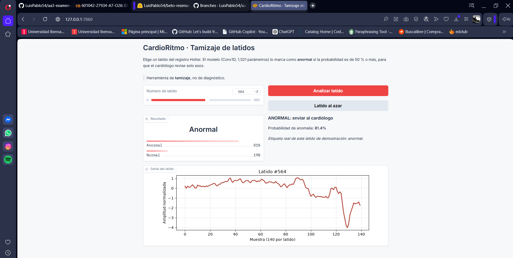
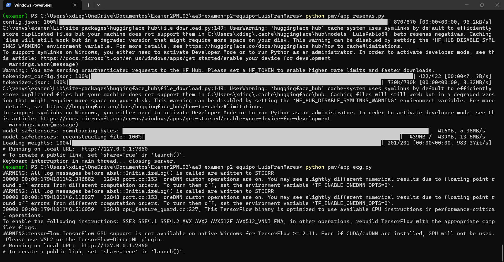
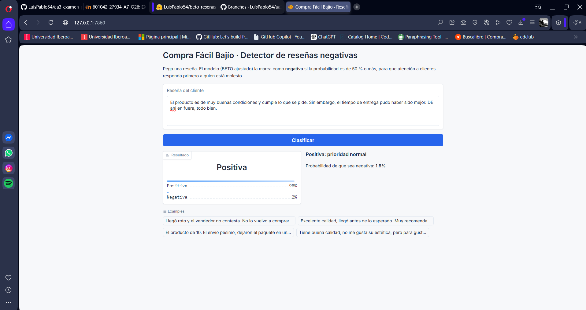
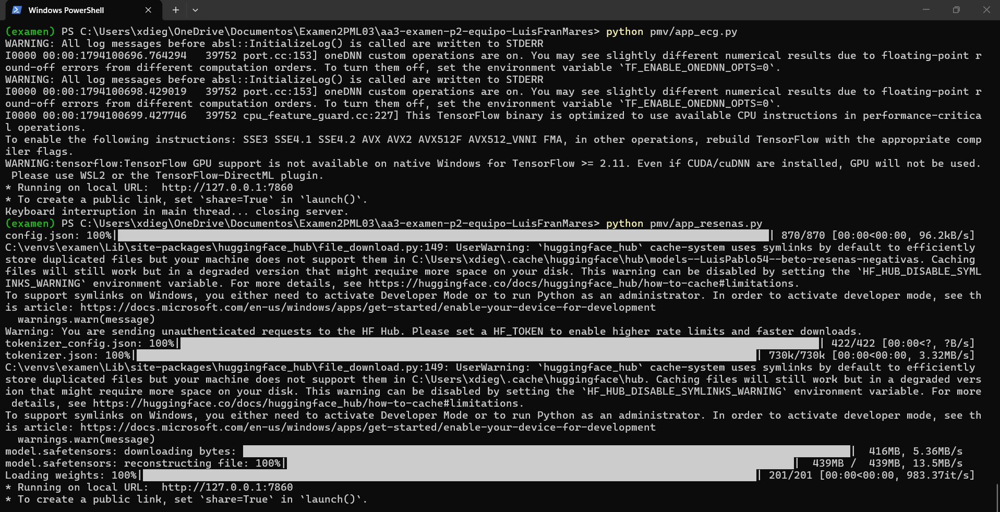

# aa3-examen-p2-equipo-LuisFranMares

Examen del Parcial II — IN1042 Aprendizaje Automático III (Otoño 2026, grupo A7).

## Integrantes y quién hizo qué

| Integrante | Trabajo |
|---|---|
| Luis Pablo López Iracheta | Problema 2 · Compra Fácil Bajío (reseñas): DEV, resultados y modelo |
| Francisco Marín Castillo | Problema 1 · CardioRitmo (ECG): DEV, resultados y modelo |
| Diego Mares Rodriguez | Folletos de ambos problemas, PMV (apps de Gradio y capturas) y README |

## Modelo elegido por problema

| Problema | Modelo elegido | ¿Cumple? | Archivo / enlace |
|---|---|---|---|
| CardioRitmo (ECG) | Conv1D pequeño (1,521 parámetros) | Sí: sensibilidad 0.978, especificidad 0.997 en prueba | [`ecg/modelo/modelo_ecg.keras`](ecg/modelo/modelo_ecg.keras) (55 KB) |
| Compra Fácil Bajío (reseñas) | BETO ajustado (`dccuchile/bert-base-spanish-wwm-cased`) | Sí: exhaustividad 0.957, precisión 0.931 en prueba | ~440 MB, no cabe en GitHub: [huggingface.co/LuisPablo54/beto-resenas-negativas](https://huggingface.co/LuisPablo54/beto-resenas-negativas) |

## Folletos

- CardioRitmo: [`ecg/folleto_ecg.pdf`](ecg/folleto_ecg.pdf)
- Compra Fácil Bajío: [`resenas/folleto_resenas.pdf`](resenas/folleto_resenas.pdf)

## Estructura

```
├── README.md
├── requirements.txt
├── ecg/
│   ├── DEV_ecg.ipynb
│   ├── resultados_ecg.csv
│   ├── modelo/modelo_ecg.keras
│   └── folleto_ecg.pdf
├── resenas/
│   ├── DEV_resenas.ipynb
│   ├── resultados_resenas.csv
│   ├── modelo/              (el modelo está en Hugging Face, ver arriba)
│   └── folleto_resenas.pdf
└── pmv/
    ├── app_ecg.py
    ├── app_resenas.py
    └── capturas (.png)
```

## PMV (punto extra)

Dos apps web locales hechas con Gradio, una por problema. Cada una usa el modelo elegido y clasifica.

| App | Modelo que usa | Qué hace |
|---|---|---|
| `pmv/app_ecg.py` | `ecg/modelo/modelo_ecg.keras` | Se elige un latido del registro, da la probabilidad de anomalía y lo marca como **anormal** (enviar al cardiólogo) si es ≥ 0.5. Muestra la gráfica del latido. |
| `pmv/app_resenas.py` | BETO ajustado de Hugging Face | Se pega una reseña, da la probabilidad de que sea negativa y la marca como **prioridad alta** si es ≥ 0.5. |

### Cómo correrlas

Requiere **Python 3.12** (TensorFlow no funciona con Python 3.14).

```bash
# 1. Crear y activar un entorno virtual
py -3.12 -m venv .venv              # en Mac/Linux: python3.12 -m venv .venv
.venv\Scripts\Activate.ps1          # en Mac/Linux: source .venv/bin/activate

# 2. Instalar dependencias (desde la raíz del repo)
pip install -r requirements.txt

# 3. Correr una app y abrir http://127.0.0.1:7860
python pmv/app_ecg.py
python pmv/app_resenas.py
```

- La app de ECG descarga el archivo `ecg.csv` del enunciado para tener latidos de demostración, así que necesita internet.
- La app de reseñas descarga el modelo de Hugging Face (~440 MB) la primera vez; después queda guardado en la computadora.
- Para cerrar una app: `Ctrl + C` en la terminal. Solo se puede correr una a la vez en el puerto 7860.

### Capturas

**CardioRitmo (ECG)**




**Compra Fácil Bajío (reseñas)**



